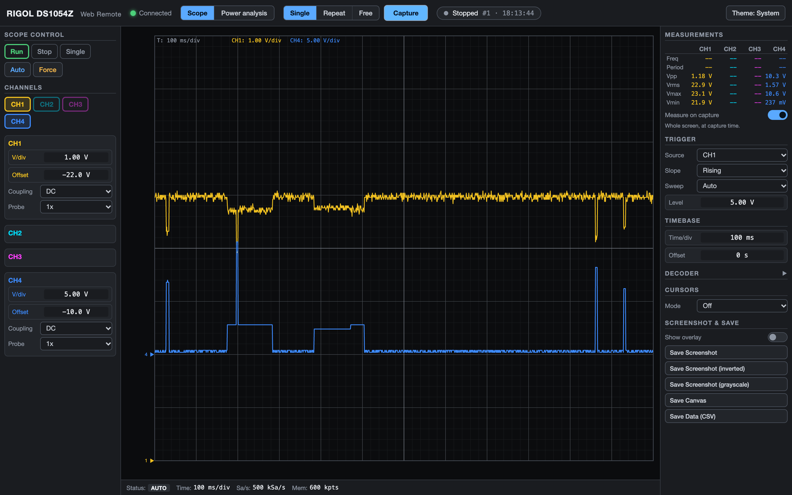
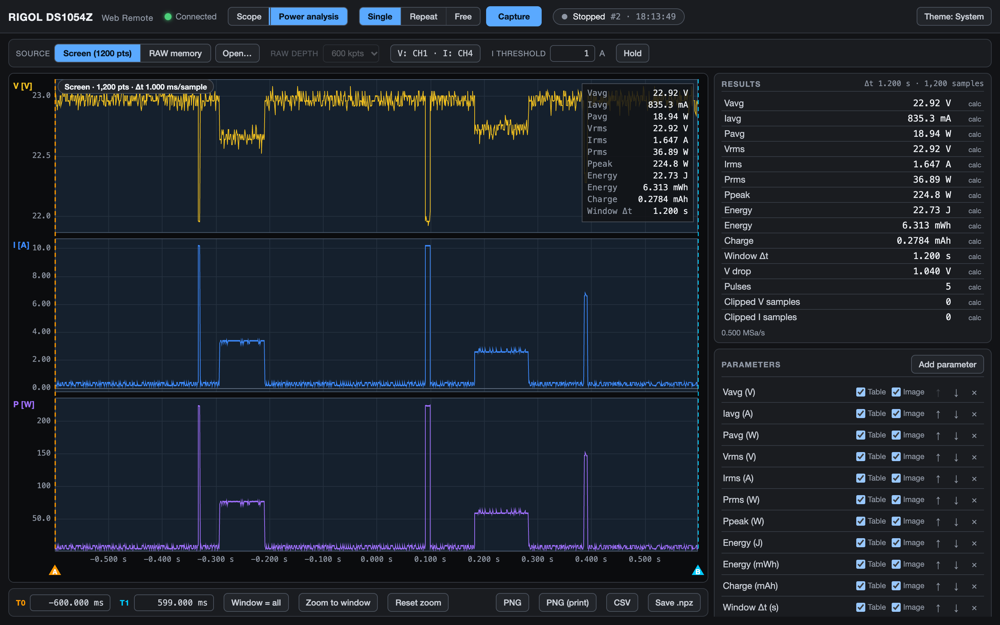

# Rigol DS1054Z Web Remote

Remote control GUI for the Rigol DS1054Z oscilloscope (and DS1000Z/MSO1000Z series), accessible from any browser on the local network.

## Features

- **Trigger-driven captures** — Single / Repeat / Free. In Single and Repeat every channel of a capture comes from the *same acquisition* (read while the scope is stopped). Free reads the screen without stopping and flags the capture "channels may be from different triggers".
- **Scope view** — responsive canvas (12×8 grid), full oscilloscope control (Run/Stop/Single/Auto, V/div, Time/div, trigger, coupling, probe), measurements that arrive with each capture, draggable X/Y cursors, protocol decoder config, screenshot overlay and exports
- **Power analysis view** — V, I and P = v·i in three lanes on a shared time axis, draggable t0–t1 window, average and RMS V / I, average power (and Prms), energy (J, mWh), charge (mAh), pulse statistics, a parameter picker that mixes computed values and scope `:MEAS:ITEM?` values, PNG / CSV / `.npz` export
- **RAW memory read** — reads the scope's internal memory (6 k … 12 M points) in 250 000-point chunks so averages and energy use millions of samples instead of the 1200 screen points
- **Light / dark / system themes**
- **Fake scope** — `python3.11 run.py --fake` develops and tests without hardware
- **Auto-discovery** — finds the scope on the network automatically (TCP probe on port 5555)
- **CLI** — commands for scripting and automation, interactive SCPI shell, `raw-data` to save RAW memory as `.npz`
- **Debug log file** — `--debug` writes a per-run log with the full SCPI trace (see [Debug logging](#debug-logging))
- **Double-click launcher** — `launch.command` for macOS, opens Terminal + browser

## Screenshots

Both views running against the built-in fake scope (`python3.11 run.py --fake`); they follow the system light/dark theme.

**Scope view** — channel controls, measurements that arrive with each capture, trigger, timebase, cursors and exports.

<picture>
  <source media="(prefers-color-scheme: light)" srcset="screenshots/scope-light.png">
  
</picture>

**Power analysis view** — V, I and P = v·i on a shared time axis, A/B window cursors, and the Results table with average and RMS values, energy and charge.

<picture>
  <source media="(prefers-color-scheme: light)" srcset="screenshots/power-analysis-light.png">
  
</picture>

## Requirements

- Python 3.11+ (macOS: `brew install python@3.11`)
- Rigol DS1054Z (or DS1074Z, DS1104Z, MSO1074Z, MSO1104Z, and "Plus" variants) connected via Ethernet
- The scope must be on the same network as the computer

## Quick Start

```bash
# Install dependencies (numpy is new; requirements-dev.txt adds pytest + httpx for the tests)
pip3.11 install -r requirements.txt

# Launch — auto-discovers the scope on the network
python3.11 run.py

# Or specify the scope IP directly
python3.11 run.py 192.168.1.100

# Or list all scopes found on the network
python3.11 run.py discover

# Or try everything against the built-in fake scope (no hardware)
python3.11 run.py --fake

# Or just double-click launch.command in Finder
```

Open `http://localhost:8082` (the default port) in any browser on the network.

## Power analysis: measuring average power and energy

1. Connect the voltage probe and the current probe (e.g. V on CH1, I on CH4 — the default; change it with the `V: CH1 · I: CH4` button).
2. Switch to **Power analysis**. Pick the **Source**:
   - **Screen (1200 pts)** — what is on the scope screen at the trigger.
   - **RAW memory** — the whole acquisition memory. Choose the **RAW depth** (only the values valid for the enabled channels are offered; with two channels: 6 k, 60 k, **600 k** (default), 6 M, 12 M). The depth is applied before arming and read back; a toast tells you if the scope coerced it.
3. Choose **Single** (arm once), **Repeat** (re-arm after each capture) or **Free**, and press **Capture** (`C`). RAW capture shows progress, ETA and a Cancel button; the real throughput is logged and shown in the toast.
4. Drag the **A / B cursors** (or type `t0` / `t1`, or use `[` `]` to nudge the active cursor by one pixel column, `Shift` for 10; `Tab` switches cursor, `A` window = all, `Z` zoom to window). The Results table updates for the window: Vavg, Iavg, Vrms, Irms, Pavg = mean(v·i) (not Vavg·Iavg), Prms, Ppeak, Energy = Pavg·Δt (J and mWh), Charge (mAh), window Δt, plus V drop, pulses and clipped-sample counts. Mouse wheel zooms around the pointer, dragging empty area pans.
5. **Parameters** picks what is shown in the Table and drawn on the Image; scope parameters (`:MEAS:ITEM?`, whole screen, queried only at capture time) are tagged "scope · full screen". The selection is remembered in the browser.
6. **Hold** keeps the current capture while Repeat keeps running. **PNG**, **PNG (print)** (light theme), **CSV** (window only), **Save .npz** (raw bytes + preambles, loads bit-exactly). **Open…** loads a `.npz` or the app's CSV export (`Save Data (CSV)` in the scope view).

Why Pavg and not Prms: energy is the integral of v·i, so `E = Pavg · Δt`. `Prms = sqrt(mean(p²))` has no physical meaning and overestimates energy for pulsed loads. **Irms** matters for I²R heating of cables and fuses; **Vrms · Irms** is the apparent power S and `Pavg / S` is the power factor.

Samples where the ADC clipped (raw 0 or 255) are excluded from every statistic and counted (warning row).

## Debug logging

```bash
python3.11 run.py --debug                      # log file in the default location
python3.11 run.py --debug --log-dir ~/my-logs  # choose the directory
./launch.command --debug                       # the launcher forwards its arguments
python3.11 ds1054z-cli.py --debug 192.168.1.100 info   # CLI: option goes before the IP
```

- One file per run, `ds1054z_YYYYMMDD_HHMMSS.log` (`ds1054z-cli_…` for the CLI), UTF-8, rotated at 5 MB (5 backups). The 20 newest runs are kept.
- Default directory: `~/Library/Logs/Rigol_DS1054Z` on macOS (visible in Console.app), `~/.local/state/rigol_ds1054z/logs` elsewhere. The path is printed at start-up.
- The file records DEBUG for `rigol.*` and `server.*`: every SCPI write and query with the reply, block lengths, RAW chunk ranges and timings, trigger status changes, reconnects, and the uvicorn access log. The first lines hold the arguments, Python version and scope target; `*IDN?` is logged once connected. Binary payloads are never logged (lengths only) and text replies are cut at 200 characters.
- The console stays at INFO. `DS1054Z_DEBUG=1` still prints the transport trace on the console.
- The **Logs** button in the top bar opens the log folder in Finder (or the file manager). It works only from the machine running the server; from another computer the server refuses. Without `--debug` it opens the folder with earlier logs, or says there is none yet.
- Without `--debug` no file is created. When testing on real hardware, run with `--debug` and keep the log if something fails.

## CLI

```bash
# Discovery
python3.11 ds1054z-cli.py discover                          # find scopes on the network

# Information
python3.11 ds1054z-cli.py 192.168.1.100 info                # model, serial, firmware
python3.11 ds1054z-cli.py 192.168.1.100 settings            # full scope state (channels, trigger, timebase)

# Control
python3.11 ds1054z-cli.py 192.168.1.100 run                 # start acquisition
python3.11 ds1054z-cli.py 192.168.1.100 stop                # stop acquisition
python3.11 ds1054z-cli.py 192.168.1.100 single              # arm single trigger

# Capture
python3.11 ds1054z-cli.py 192.168.1.100 screenshot          # save PNG
python3.11 ds1054z-cli.py 192.168.1.100 screenshot --invert # white background (for printing)
python3.11 ds1054z-cli.py 192.168.1.100 screenshot --grayscale
python3.11 ds1054z-cli.py 192.168.1.100 save-data           # export waveform CSV (active channels)
python3.11 ds1054z-cli.py 192.168.1.100 save-data --mode RAW --channels 1,2
python3.11 ds1054z-cli.py 192.168.1.100 raw-data --channels 1,4 --mdep 600000 --out capture.npz   # chunked RAW read
python3.11 ds1054z-cli.py 192.168.1.100 raw-data --channels 1,4 --single --out capture.npz        # arm and wait first

# Measurements
python3.11 ds1054z-cli.py 192.168.1.100 measure 1 freq      # read frequency on CH1
python3.11 ds1054z-cli.py 192.168.1.100 measure 2 vpp       # read Vpp on CH2

# SCPI
python3.11 ds1054z-cli.py 192.168.1.100 cmd ":TRIG:STAT?"   # send raw SCPI command
python3.11 ds1054z-cli.py 192.168.1.100 shell               # interactive SCPI shell

# Web GUI
python3.11 ds1054z-cli.py 192.168.1.100 web                 # launch the web server
```

## How It Works

The scope exposes SCPI commands over raw TCP on port 5555. The app connects directly — no VISA, no drivers, no VXI-11 (which is 27x slower).

**Backend** (Python 3.11 / FastAPI): one persistent TCP connection to the scope; a priority queue serializes all SCPI communication (the scope only handles one session at a time; user controls first, screenshots last). A shared acquisition manager owns the trigger watching, snapshots, RAW reads and a 5 s state poll, so N browser tabs cause no extra scope traffic. The analysis engine (numpy) computes window statistics and drawing envelopes.

**Frontend** (vanilla JS ES modules / Canvas 2D, no build step): the scope view draws committed captures; the Power analysis view draws from a server-built min/max envelope so peaks survive at any zoom, even with 12 M points.

The scope parses each write as one SCPI program message, so **queries must be sent one per write** (two queries in one write come back as a single `;`-joined reply and the read times out). The transport never pipelines queries; setters may share a write with one trailing query.

There is **no continuous waveform streaming**: captures are trigger-driven. Idle traffic is just the 5 s state poll.

## Tests

```bash
pip3.11 install -r requirements-dev.txt
python3.11 -m pytest          # analysis golden values, RAW chunking, acquisition state machine, server end-to-end
```

## Project Structure

```
Rigol_DS1054Z/
├── run.py                  # Web server entry (auto-discover, IP, or --fake)
├── ds1054z-cli.py          # CLI (incl. raw-data), SCPI shell, discovery
├── launch.command          # macOS double-click launcher
├── requirements*.txt       # runtime (fastapi, uvicorn, numpy) / dev (pytest, httpx)
├── Docs/                   # your local copies of Rigol's manuals (PDFs are git-ignored)
├── screenshots/            # images used in this README
├── LICENSE                 # MIT
├── tests/                  # pytest suite + fixtures/ (a real 24 V capture)
│
├── rigol/                  # scope communication + analysis (no web code)
│   ├── transport.py        # one persistent raw-TCP SCPI socket, block reads, trailing-byte drain
│   ├── scheduler.py        # async priority queue (single SCPI session)
│   ├── scope.py            # DS1054Z high-level async API
│   ├── acquisition.py      # Single/Repeat/Free manager, trigger watcher, RAW flow
│   ├── raw_reader.py       # chunked RAW memory read
│   ├── logsetup.py         # console + --debug rotating file logging
│   ├── analysis.py         # window stats, envelope, npz/csv I/O (numpy)
│   ├── capture.py          # ScreenCapture container
│   ├── fake_scope.py       # hardware-free SCPI server (run.py --fake)
│   ├── waveform.py         # preamble + volt conversion helpers
│   └── discovery.py        # network discovery
│
├── server/
│   ├── app.py              # FastAPI routes, lifespan, analysis import/export
│   ├── ws_handler.py       # per-socket receive/command/analysis tasks
│   ├── hub.py              # client registry + broadcast
│   └── analysis_service.py # shared current analysis capture
│
└── static/                 # browser frontend
    ├── index.html  style.css (theme tokens)  app.js  bus.js  theme.js  toast.js  popover.js
    ├── renderer.js layout.js cursors.js controls.js measurements.js screenshot.js acquisition.js paramsync.js
    └── analysis/           # view.js plot.js results.js params.js format.js export.js (dev.js with ?dev=1)
```

## Scope Configuration

On the oscilloscope: **Utility → IO Setting → LAN Config** — note the IP address. The scope must have a static IP or DHCP reservation for reliable connection.

Recommended firmware: **00.04.04.SP3** or later.

## Documentation

Rigol's official manuals are not redistributed here. Download them from Rigol's website (search for "DS1000Z programming guide"):
- Programming Guide: full SCPI command reference
- User Guide and Quick Guide
- MSO1000Z/DS1000Z datasheet

If you keep a local copy, put it in `Docs/` (ignored by git).

## Related Project

The same transport, scheduler and discovery modules can be reused for other Rigol instruments, for example the DL3021A electronic load.

## License

MIT — see [LICENSE](LICENSE). Not affiliated with or endorsed by RIGOL Technologies.
